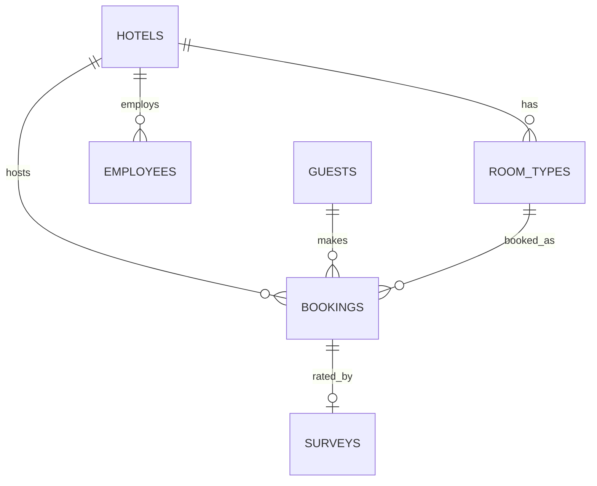

# Hospitality KPI Analytics Project

End-to-end project: **SQL data model → pandas sample data (5 years) → SQL aggregate tables → dashboard → inference document.**

KPIs: **Occupancy Rate · ADR · RevPAR · Guest Satisfaction Score · Employee Turnover Rate**

## Quick start (about 2 minutes)

```bash
# 1. open this folder in VS Code, then open a terminal (Ctrl+`)
python -m venv .venv
.venv\Scripts\activate            # Windows      |  source .venv/bin/activate   (Mac/Linux)
pip install -r requirements.txt

# 2. build data + database + aggregates + inference doc (~30 seconds)
python run_all.py

# 3. launch the dashboard (opens http://localhost:8501)
streamlit run dashboard/app.py
```

Requires Python 3.10+. No database server is needed (SQLite is a single file: `data/hospitality.db`).
In VS Code you can also use **Run and Debug** (▶): the repo ships two launch configs.

## Project structure

```
run_all.py                  one-command pipeline
sql/schema.sql              CREATE TABLE statements (data model, UUID keys, FKs, indexes)
sql/aggregates.sql          SQL that builds dimension, fact and KPI aggregate tables
src/generate_data.py        pandas/numpy/faker sample-data generator (trends + variations)
src/build_db.py             creates DB, loads CSVs, runs aggregates.sql
src/generate_inference.py   writes docs/INFERENCE.md from the aggregate tables
dashboard/app.py            Streamlit dashboard (reads aggregate tables only)
docs/INFERENCE.md           the "stories behind the variations" document
data/raw/*.csv              generated CSVs      data/hospitality.db   SQLite database
```

## Requirement checklist

| Requirement | Where |
|---|---|
| Create a SQL database with the data model | `sql/schema.sql`, `src/build_db.py` |
| Pandas sample data for 5 years (2021-2025) | `src/generate_data.py` (about 305k bookings, 127k guests, 96k surveys, 1.2k employees) |
| Trends and variations incorporated | seasonal curves per hotel, post-COVID recovery trend, ADR inflation, weekday/weekend patterns, Diwali/New Year spikes, real-world events (see below) |
| IDs are UUIDs | every table's primary key is a UUID v4 string |
| Realistic names | Faker name pools (Indian + international guests), real Indian cities/hotels, INR prices |
| SQL queries that create aggregate tables | `sql/aggregates.sql` (10 aggregate tables + 3 dimension/fact tables) |
| Business logic to join tables | stays exploded to one row per night (`fact_stay_night`), every hotel x day in `fact_daily_hotel`, only `Completed` bookings count, satisfaction attributed to check-out month, headcount from hire/termination dates |
| Aggregate tables connected to a dashboard tool | Streamlit reads `agg_*` tables directly via SQL |
| One panel per KPI | panels 1-5 on the dashboard (turnover has a second view) |
| Inference document | `docs/INFERENCE.md` |

## Data model



The reference model's Hotel, Guest and Employee entities are kept. Added entities: `room_types` (room inventory = *available rooms*), `bookings` (the Hotel-Guest relationship carrying dates, rate, revenue, channel) and `surveys` (guest satisfaction). Hotel-Employee is `employees.hotel_id`.

## Aggregate tables

| Table | Grain | Used for |
|---|---|---|
| `dim_date`, `dim_month`, `nums` | day / month | calendar logic |
| `fact_stay_night` | booking x night | base fact |
| `fact_daily_hotel` | hotel x day | rooms available / occupied / revenue |
| `agg_survey_monthly`, `agg_staff_monthly` | hotel x month | building blocks |
| **`agg_hotel_monthly`** | hotel x month | all 5 KPIs (main dashboard source) |
| `agg_portfolio_monthly`, `agg_hotel_yearly` | month / hotel x year | roll-ups |
| `agg_seasonality`, `agg_dow` | hotel x calendar month / weekday | seasonality panels |
| `agg_segment_monthly`, `agg_booking_status_monthly`, `agg_staff_reason` | various | mix, cancellations, exit reasons |

KPI formulas (from additive columns, so they re-aggregate correctly):
`Occupancy = occupied room-nights / available room-nights` · `ADR = room revenue / occupied room-nights` · `RevPAR = room revenue / available room-nights` · `Satisfaction = sum(scores) / survey count` · `Turnover = leavers / average headcount`.

## Trends and variations built into the data

* **Seasonality** is different for each hotel type: Goa beach (peak Nov-Feb), Manali hills (May-Jun and Dec), Jaipur heritage (Oct-Mar), Mumbai and Chennai business hotels (flat, weekday-driven).
* **Trend:** occupancy recovers from ~0.82x to ~1.09x of baseline; ADR grows ~5.5% a year; prices follow demand (peak-season pricing / off-season discounts).
* **Events:** COVID second wave (2021), Omicron (Jan 2022), Himachal floods hitting Manali (Jul-Aug 2023), Cyclone Michaung hitting Chennai (Dec 2023), Jaipur renovation (satisfaction dip, 2024), Diwali and New Year spikes.
* **Satisfaction** falls when a hotel is crowded (>80% occupancy) and when staff turnover is high.
* **Turnover** rises with workload and in appraisal months (Jan/Apr); seasonal contracts are hired before peaks and released afterwards.
* A few peak days exceed 100% occupancy (~1.4% of hotel-days). This is intentional *overbooking*, which is realistic; monthly KPIs never exceed 100%.

## Presenting / using another BI tool

The dashboard is Streamlit. To use **Power BI / Tableau / Metabase / Excel** instead, connect to `data/hospitality.db` (SQLite ODBC driver), or export the aggregate tables to CSV:

```python
import sqlite3, pandas as pd
con = sqlite3.connect("data/hospitality.db")
for t in ["agg_hotel_monthly", "agg_seasonality", "agg_dow", "agg_hotel_yearly"]:
    pd.read_sql(f"SELECT * FROM {t}", con).to_csv(f"data/{t}.csv", index=False)
```

SQL is SQLite dialect. To move to PostgreSQL/MySQL: replace `strftime`/`date(x,'+n day')` with `to_char`/`date + interval`, and the recursive CTE with `generate_series` (Postgres).

## Troubleshooting

* `streamlit: command not found` → activate the virtual environment, or run `python -m streamlit run dashboard/app.py`.
* Dashboard says *Database not found* → run `python run_all.py` first.
* To regenerate with different data change `SEED` or the config at the top of `src/generate_data.py`, then re-run `python run_all.py` (the inference document refreshes automatically).
